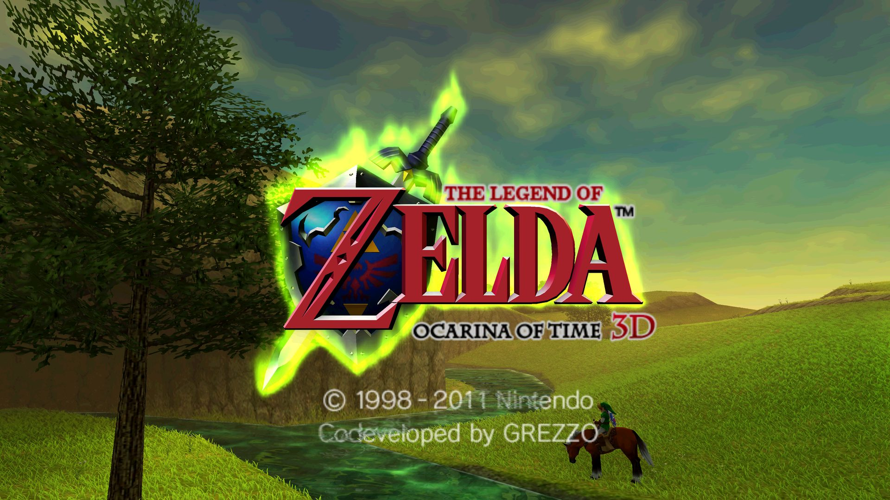
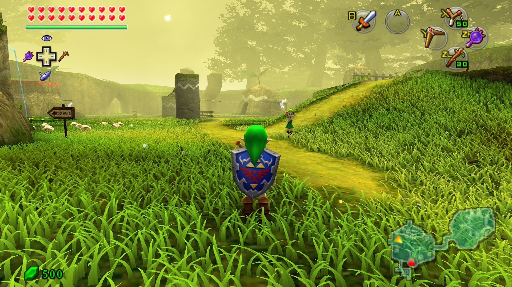
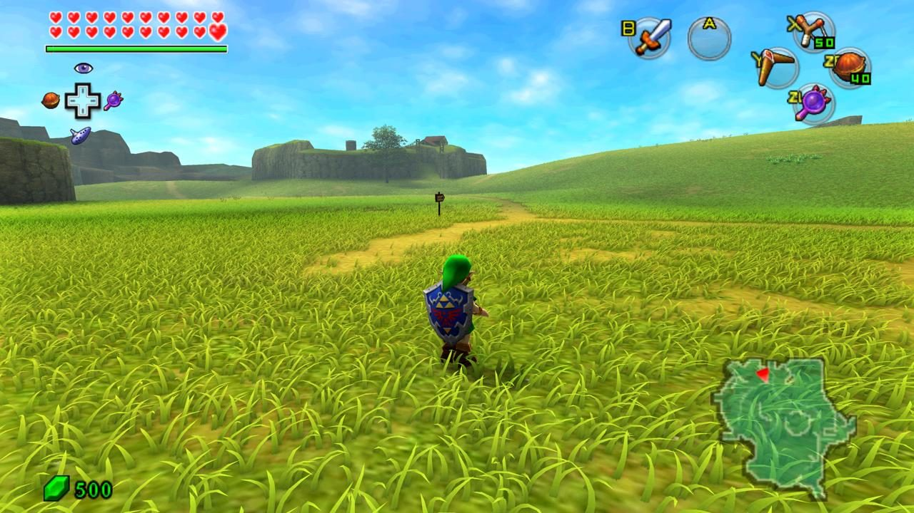
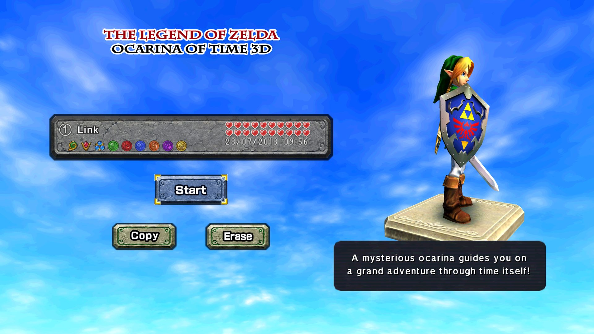
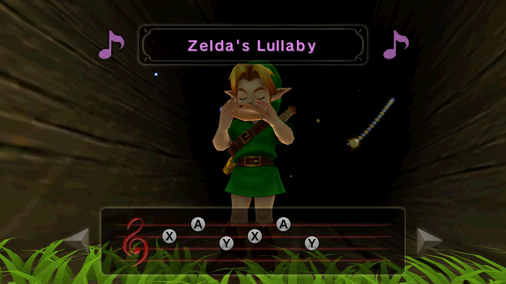
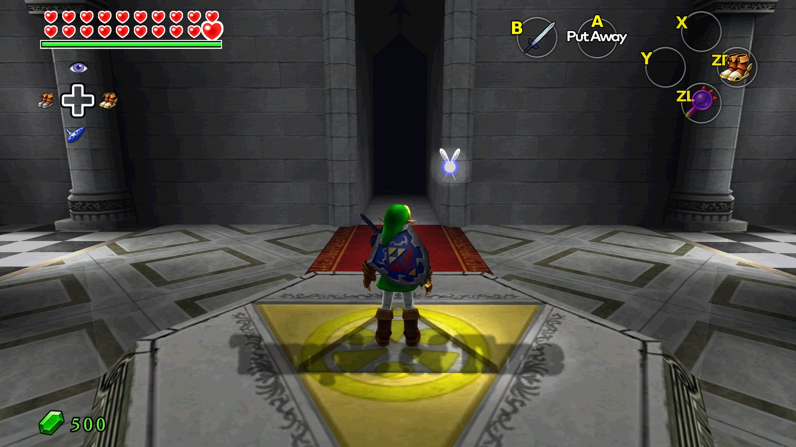
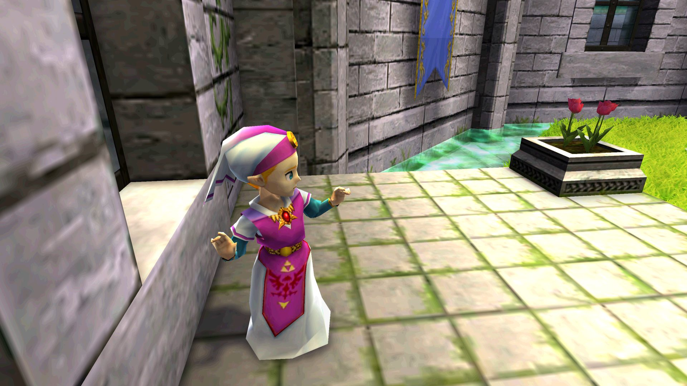
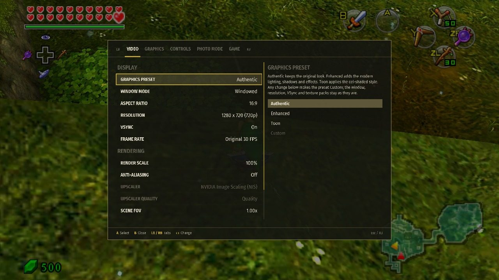
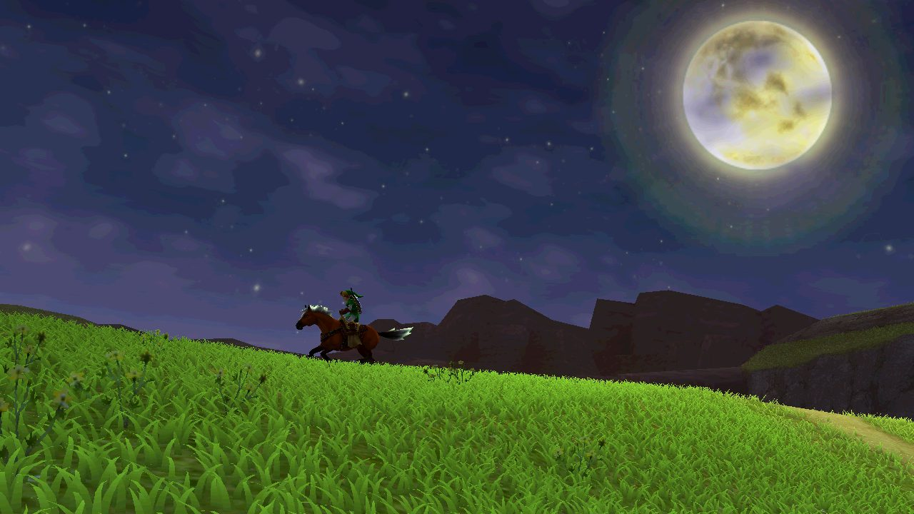

# TriAevum — Echoes of Time

  

A native PC AOT recompilation of *The Legend of Zelda: Ocarina of Time 3D*,
with a modern NRI/Vulkan renderer, a single-screen interface and customizable
graphics. *Echoes of Time* is TriAevum's Ocarina of Time 3D project;
executables, data folders and package names keep the TriAevum name.

**Current release: [v0.8.0-beta.1.2](https://github.com/coccofresco/TriAevum/releases/latest)**
for Windows (ZIP) and Linux (AppImage and Flatpak). It is a beta: back up your
saves, and read the [release notes](docs/releases/v0.8.0-beta.1.2.md) before
assuming something is a feature.

## Credit Where It Belongs

Before the shaders, settings and excessive grass: **Echoes of Time would not exist in
its current form without [TopScreen, now SingleScreen](https://gamebanana.com/mods/695893),
developed by rlgcarrot**. Its single-screen experience is reimplemented here for
our runtime, but the vision, care and tremendous work behind it deserve a
special thank-you. Please consider [buying rlgcarrot a coffee](https://ko-fi.com/rlgcarrot)
to support that fantastic work.

The HD interface comes from **[OoT3D Vanilla UI/HUD](https://gamebanana.com/mods/701929)**
by **chubbycubby**, which Forge downloads for your game's language with your
consent, and the file selection follows the single-screen design of
**[Ocarina Reframed](https://github.com/OTPR26/OOT3DHud)** by **OTPR26**.

The ambient occlusion that makes the grass look like it belongs to the ground
is **MXAO** from **[iMMERSE](https://github.com/martymcmodding/iMMERSE)** by
**Pascal Gilcher** ([Marty's Mods](https://martysmods.com)), integrated and
adapted with his explicit permission. Thank you for lending TriAevum a piece
of work that took years to get this good.

Just as essential are **Azahar, Ship of Harkinian, libultraship, NVIDIA NRI**,
and the SDL controller-mapping community. And, of course, **Nintendo and
Grezzo**, who created the original game. [Full credits and licenses](THIRD_PARTY_NOTICES.md).

Forge can also apply an optional mod on your machine: **[Vanilla+ - Link Remodel
And HD Item Models](https://gamebanana.com/mods/705890)** by **HugAMuffin**
(testing by Fado, M-1 and seiunsky_1084; tooling by Jameriquiah). TriAevum does
not distribute it: Forge downloads the author's original archive when you turn
it on ([details](docs/TRIAEVUM_MOD_VANILLA_PLUS_LINK.md)).

**Separately licensed material.** Three parts are not covered by TriAevum's GPL
and keep their authors' terms:

- **iMMERSE / MXAO** (Pascal Gilcher): "All rights reserved". The module is
  built as its own library, shipped beside the runtime, and TriAevum uses it
  under a permission granted to this project only. That permission does not
  pass to forks, recipients or other projects; redistribute TriAevum without
  the module unless the author has given you his own. See
  [LICENSE_SCOPE.md](LICENSE_SCOPE.md#exception-the-immerse-module) and the
  module's `LICENSE-iMMERSE.txt`.
- **OoT3D Vanilla UI/HUD** (chubbycubby): [CC BY-NC-ND 4.0](https://creativecommons.org/licenses/by-nc-nd/4.0/).
  Packages contain none of its files; Forge downloads the author's original
  archive from GameBanana on your request and keeps it in your private data
  folder. See [LICENSES/OoT3D-Vanilla-UI-HUD.md](LICENSES/OoT3D-Vanilla-UI-HUD.md).
- **Vanilla+ - Link Remodel And HD Item Models** (HugAMuffin): [CC BY-NC-ND 4.0](https://creativecommons.org/licenses/by-nc-nd/4.0/).
  Same arrangement: downloaded from GameBanana only when you turn it on, never
  redistributed by TriAevum. See [LICENSES/Vanilla-Plus-Link-Remodel.md](LICENSES/Vanilla-Plus-Link-Remodel.md).

## About

Echoes of Time is an AOT recomp in the same general spirit as the Xbox 360 recomp
projects. I just ended up spending most of my time on the renderer instead of,
you know, actually playing the game. The goal is to push the visuals further
without completely losing the original look.

**Development of this project is entirely AI-assisted, under human direction.**
That describes the TriAevum-specific work, not the mature donor projects and
libraries it builds on: Azahar, Ship of Harkinian, NRI and others. Aside from
those foundations, you could fairly call this concentrated AI slop.
Apparently, even AI slop can still consume several months of your life.

## Install

Requires Windows or Linux x64, a Vulkan-capable GPU with current drivers, and
your own supported decrypted ROM. Forge accepts `.3ds` and `.cci` and checks
the contents, not just the filename.

It should work with any personal EUR or USA ROM dump (original or Rev 1),
provided it is decrypted and in `.cci` or `.3ds` format. Japanese, Korean and
Taiwanese releases are not supported yet.
See [ROM compatibility details](docs/TRIAEVUM_CONTENT_FAMILY_IMPORT.md).

### Windows

1. Download the **Windows-x64 ZIP**, not GitHub's source-code archive, and
   extract it into a writable folder. Besides `README.md` and `LICENSE`, its
   only file is `TriAevumForge.exe`; everything else is in subfolders.
2. Run `TriAevumForge.exe` and select your decrypted ROM. The HD font is
   included. For the HD HUD and menus, leave **Download the HD textures**
   checked (chubbycubby's OoT3D Vanilla UI/HUD, in the language your ROM boots
   in; if the download fails, select the zip from
   [the mod page](https://gamebanana.com/mods/701929) yourself).
3. When setup finishes, choose **Launch game**. Setup places `TriAevum.exe`
   beside Forge; afterwards, use `TriAevum.exe`.

Keep the folder path reasonably short: Windows still has a 259-character path
limit, and Forge now tells you how many characters to give back instead of
letting Windows find out for you.

### Linux and Steam Deck

Both packages are qualified on a desktop with an AMD GPU (Mesa RADV); earlier
betas were qualified on NVIDIA's proprietary driver.

- **AppImage**: download the **Linux-x86_64.AppImage**, make it executable in
  your file manager or with `chmod +x TriAevum-*.AppImage`, open it and select
  your decrypted ROM in Forge. `--forge` reopens preparation;
  `--appimage-extract-and-run` works on systems without FUSE. Your data lives in
  `$XDG_DATA_HOME/TriAevum` (normally `~/.local/share/TriAevum`).
- **Flatpak**: `flatpak install --user TriAevum-*-Linux-x86_64.flatpak`, then
  launch TriAevum from your applications menu. Your data lives in
  `~/.var/app/io.github.coccofresco.TriAevum/`.

On Steam Deck, prepare in Desktop Mode, then add the same AppImage as a non-Steam
game. Use Steam Input's Gamepad layout without Proton. Physical Steam Deck and
Gaming Mode testing have not yet been performed; the AMD qualification machine
is a desktop.

No compiler or SDK is needed. No ROM or original game assets are included.
Forge prepares the bundled shaders for your GPU during setup (a few minutes
the first time on a machine); shaders encountered later are cached while
playing. An Internet connection is only needed for the optional HD interface
pack and mods. Back up your saves, settings and prepared data: `data/` beside
the Windows application, or the Linux folders above.

## Graphics and controls

- Cel/toon shading and outlines, as a preset you can leave off.
- Ambient occlusion, shadows, water reflections and anti-aliasing, with the
  expensive ones at half resolution so 4K no longer requires an upscaler.
- Real widescreen framing, selectable aspect ratios (16:9, 21:9, original 5:3)
  and configurable field of view.
- **60/90/120/180/240/360 FPS visual interpolation** of the original 30 Hz game state.
  Game logic and gameplay speed remain unchanged; this is not 60/90 Hz physics.
  Input is sampled late, so Link jumps when you press the button, not shortly
  after.
- Azahar-compatible custom textures and texture dumping, plus the optional
  Vanilla+ Link remodel as a local overlay.
- Reimplemented **SingleScreen** HUD, pause menus, ocarina and Sheikah Stone
  Visions on one screen, and Ocarina Reframed's file selection.
- Configurable gameplay free camera and photo mode, keyboard/mouse and
  controller inputs.
- Named settings profiles, audio and save states.
- Procedural grass. A lot of grass. Possibly too much grass, now within a VRAM
  budget so it stays where you left it.

Press **Esc** (or **R3** on a pad) for the in-game menu: the everyday
settings, navigated with the D-pad or sticks, A to select, B to go back,
LB / RB for the tabs, or with the mouse, while the game keeps running. Press
**F1** for every setting. **F2** temporarily disables the main added graphics
effects, then restores them without losing your configuration. Most of the
presentation is configurable, so if my artistic decisions offend you
personally, you can probably undo them. Effects can be expensive; adjust them
to suit your GPU.

## Screenshots

Captured directly from the renderer's framebuffer during beta.1.2 development
on Windows, with the default graphics profile, the HD interface pack and the
toon preset off. The night title screen comes from the released package's own
qualification run.

<table>
  <tr>
    <td width="50%"></td>
    <td width="50%"></td>
  </tr>
  <tr>
    <td align="center">Kokiri Forest, grass and ambient occlusion on</td>
    <td align="center">Hyrule Field, now with grass that stays put</td>
  </tr>
  <tr>
    <td></td>
    <td></td>
  </tr>
  <tr>
    <td align="center">File selection in the Ocarina Reframed layout</td>
    <td align="center">Ocarina with the melody browser on one screen</td>
  </tr>
  <tr>
    <td></td>
    <td></td>
  </tr>
  <tr>
    <td align="center">Temple of Time</td>
    <td align="center">The ending credits, which no longer crash</td>
  </tr>
  <tr>
    <td></td>
    <td></td>
  </tr>
  <tr>
    <td align="center">Esc / R3 in-game menu, game still running behind it</td>
    <td align="center">Title intro at night, from the released package</td>
  </tr>
</table>

## Testing and contributing

This is an **experimental beta**, not a fully tested port. Gameplay testing
covers the early parts of the game on the developer's side; reporters have
since taken it all the way to the credits, which is how the credits got fixed.
The USA adapter has been checked through installation, the title intro and
file selection, not a full playthrough. Linux is qualified on an AMD (Mesa
RADV) desktop; Windows AMD drivers remain untested by us. I find
tweaking shaders considerably more entertaining than finishing Zelda again, so
people willing to actually play through it are especially welcome.

Please [report issues](https://github.com/coccofresco/TriAevum/issues) with the
version, ROM input/revision, GPU/driver, settings, steps to reproduce and
`logs/oot3d_native_game.log`. **Normal in-game save files are particularly
useful for problems later in the game.** Review logs for personal information
before sharing; do not upload ROMs, extracted assets or memory savestates
containing game code.

Contributions, experiments and forks taking the renderer in other directions
are welcome. [Community contributors and PR credits](docs/TRIAEVUM_CONTRIBUTIONS.md)
are recorded separately from the original AI-assisted development. Longer term,
I would like to explore a proper ray-tracing path
and finish features still in the traditional state known as "technically
implemented". Ray tracing is a wishlist item, not a feature of this release.

[Release notes and known limitations](docs/releases/v0.8.0-beta.1.2.md);
[earlier releases](https://github.com/coccofresco/TriAevum/releases).

## Source and license

Original contributions are licensed under **GPL-3.0-or-later**. Third-party
components retain their own licenses and notices:
[license scope](LICENSE_SCOPE.md) and [third-party notices](THIRD_PARTY_NOTICES.md).
See the [release and build contract](docs/TRIAEVUM_PRECOMPILED_RELEASE.md) for
source availability and developer packaging, and the [source map](docs/TRIAEVUM_SOURCE_MAP.md)
for where the main components live.

TriAevum is independent and is not affiliated with or endorsed by Nintendo.

Worst case scenario, at least we got more grass.
